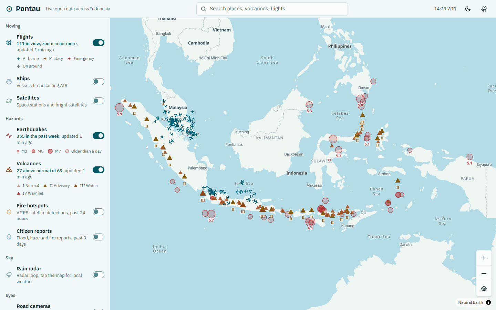
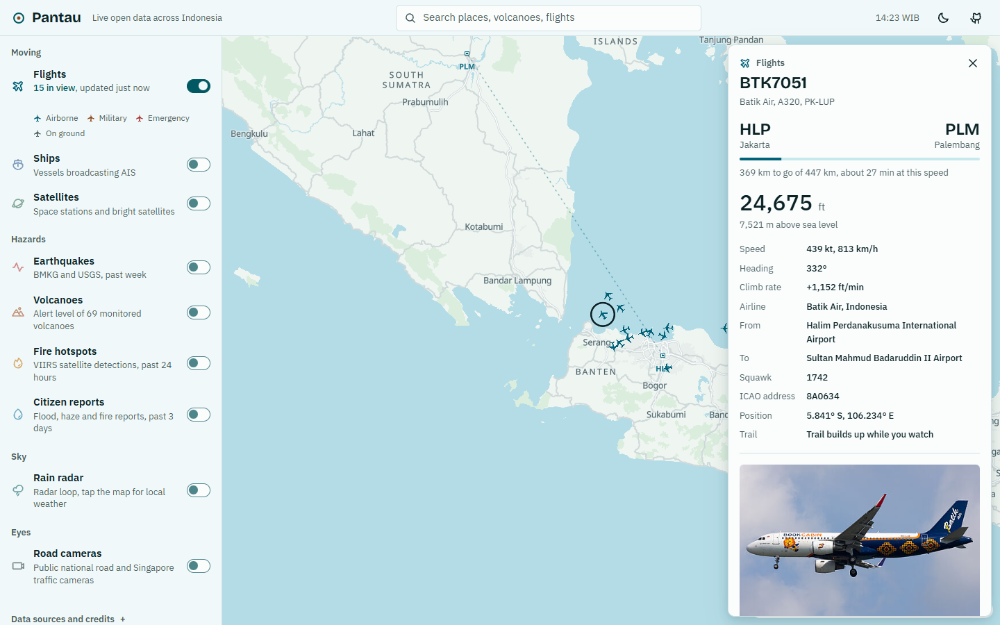
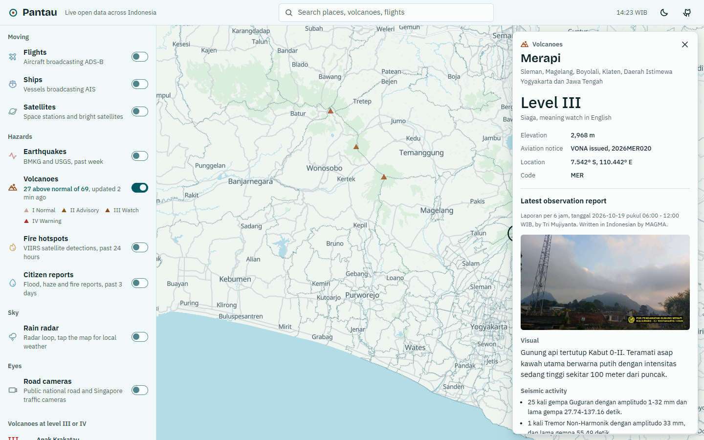
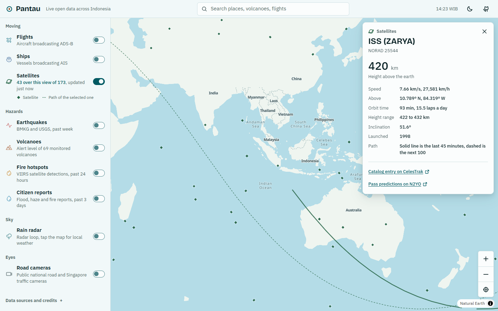
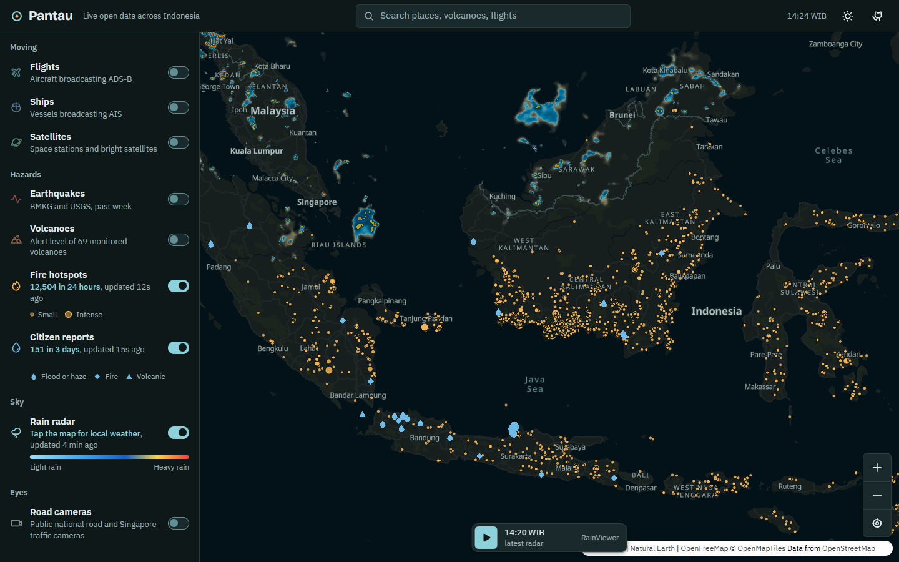
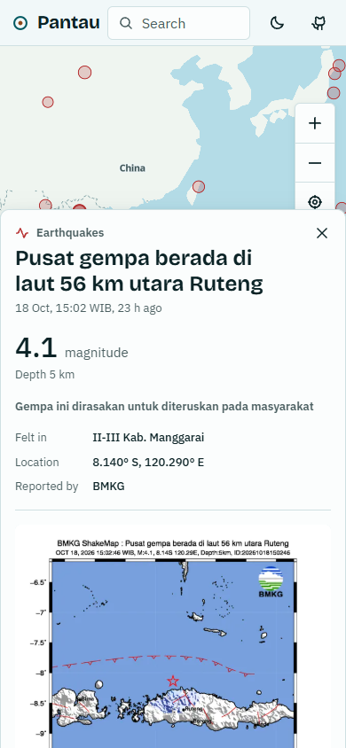

<p align="center">
  <picture>
    <source media="(prefers-color-scheme: dark)" srcset="design/logo/final/pantau-lockup-reversed.svg" />
    
  </picture>
</p>

# Pantau

A live map of Indonesia built only from free public data. Flights, ships, satellites, earthquakes, volcano alert levels, fire hotspots, citizen flood reports, rain radar, local weather and public road cameras, all on one map.

**Live:** https://marvelcollin.com/pantau/



## What you can see

| Layer | Source | Detail panel |
|---|---|---|
| Flights | adsb.lol, adsb.fi | Airline, planned route with progress and arrival estimate, altitude, speed, trail, aircraft photo |
| Ships | aisstream.io | Vessel type, speed, course, destination, trail |
| Satellites | CelesTrak | Height, speed, orbit time, height range, inclination, past and future ground track |
| Earthquakes | BMKG, USGS | Magnitude, depth, felt reports, tsunami note, BMKG shake map, other quakes nearby |
| Volcanoes | MAGMA ESDM | Alert level, latest 6 hourly observation report, seismic counts, photo, advice |
| Fire hotspots | NASA FIRMS | Fire power, confidence, hotspots within 10 km, nearest city |
| Citizen reports | PetaBencana | Report text, photo, flood depth |
| Rain radar and weather | RainViewer, Open-Meteo | Radar loop, current weather, air quality and the next 12 hours for any point you tap |
| Cameras | Jogja City, Bina Marga, LTA Singapore | 152 live city cameras in Yogyakarta, national road streams and Singapore snapshots, nearby cameras |

Every view has its own link, so the layers you turned on, the map position and the selected item can be shared.

| Flight with route | Volcano report |
|---|---|
|  |  |

| Satellites | Fires, reports and radar in dark mode |
|---|---|
|  |  |

<p align="center"></p>

Notes on every data source, with limits and quirks, are in [research.md](research.md).

## Stack

```
web/      React 19, TypeScript, Vite, MapLibre GL, TanStack Query
server/   Hono API that proxies, trims and caches upstream sources
api/      Vercel function entry that loads the built server
design/   Logo sources
```

The base map below zoom 5 is drawn from simplified Natural Earth shapes bundled with the app, so the first view loads without any map tiles. Detailed OpenFreeMap vector tiles take over from zoom 5.

## Run it locally

Needs Node 22.

```bash
npm install
cp .env.example .env
npm run dev
```

Open http://localhost:5173/pantau/. The API runs on http://localhost:8787 and Vite forwards `/pantau/api` to it.

Ships need a free key from [aisstream.io](https://aisstream.io). Sign in with GitHub, create a key, and put it in `.env` as `AISSTREAM_KEY`. Every other layer works without a key.

## Deploying

The project runs on the free Vercel Hobby plan.

* Work happens on the `dev` branch. Pushes to `dev` never deploy.
* Merging `dev` into `main` deploys production once.
* Pushes that only change Markdown files skip the build.
* `marvelcollin.com/pantau` is served by a rewrite in the main site's project that points to this project.

To deploy your own copy, import the repo in Vercel, keep the framework set to "Other" (`vercel.json` sets the rest), and add `AISSTREAM_KEY` if you want ships. Then open `/pantau/` on your deployment.

## Caching and free tier use

There are four layers of cache.

1. Vercel CDN, through `s-maxage`, `stale-while-revalidate` and `stale-if-error` on every API response.
2. Function memory, which serves stale data while it refreshes, merges identical requests and keeps the last good copy when a source is down.
3. The browser HTTP cache and ETags.
4. IndexedDB for slow changing data, so returning visitors see the map at once.

| Endpoint | Fresh for | Browser polls every |
|---|---|---|
| `/api/flights/overview` | 45 s | 45 s, below zoom 6 |
| `/api/flights?lat&lon` | 15 s | 20 s, from zoom 6 |
| `/api/quakes` | 2 min | 2 min |
| `/api/ships` | 2 min | 2 min |
| `/api/reports`, `/api/cameras` | 4 to 5 min | 5 min |
| `/api/fires`, `/api/volcanoes` | 30 min | 30 min |
| `/api/volcanoes/report` | 30 min | when opened |

A layer only polls while it is switched on and the tab is visible. Radar, weather, satellites and flight routes are fetched straight from their public APIs in the browser, so they cost nothing on Vercel. Video never passes through the server.

## Commands

```bash
npm run dev         start web and API
npm run build       build both
npm run typecheck   type check both
```

## Credits

Data from BMKG, MAGMA ESDM, NASA FIRMS, PetaBencana, adsb.lol, adsb.fi, adsbdb, Planespotters, aisstream.io, CelesTrak, RainViewer, Open-Meteo, BigDataCloud, Bina Marga, LTA Singapore, OpenFreeMap, OpenStreetMap contributors and Natural Earth. Data can be late or wrong. For emergencies follow BMKG, BNPB and local authorities.
